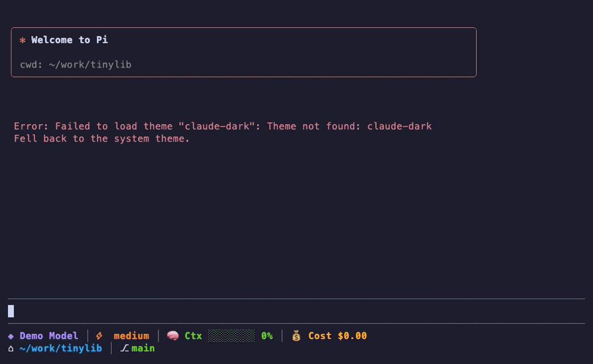

# pi-customization

[](https://github.com/fadhilmch/pi-customization/actions/workflows/ci.yml)
[](LICENSE)
[](https://pi.dev/packages)

Extensions and themes for the [Pi coding agent](https://pi.dev) that make it feel like Claude Code: the same look, an auto mode that only asks before risky actions, plan mode, a todo list, subagents, rewind checkpoints, notifications, and format/typecheck after edits.



Install all of it, or only the tools you want. Each extension is self-contained and can be installed on its own.

## Catalog

| Extension | What it does | Preview |
|---|---|---|
| [`claude-look`](extensions/claude-look/) | `⏺` bullets, `⏺ Bash(cmd)` tool lines with `⎿` output folded to 3 lines, red/green diffs, teal spinner, welcome box. Ships the `claude-dark` theme. | [png](docs/media/claude-look.png) |
| [`auto-mode`](extensions/auto-mode/) | Rule-based gate: safe tool calls run silently, risky ones ask (force push, `rm -rf`, `sudo`, deploys, secrets, writes outside the project), catastrophic ones are blocked. `/auto`, `ctrl+alt+a`. | [png](docs/media/auto-mode.png) |
| [`plan-mode`](extensions/plan-mode/) | Read-only research mode; approve a plan before anything is written. `/plan`, `ctrl+alt+p`, `pi --plan`. | [png](docs/media/plan-mode.png) |
| [`todo`](extensions/todo/) | A `todo` tool for multi-step work, shown above the editor as `☒ ◼ ☐`. `/todos`. | [png](docs/media/todo.png) |
| [`ask-user`](extensions/ask-user/) | `ask_user` tool (Claude Code's AskUserQuestion): the model asks 1-4 multiple-choice questions in a TUI picker, with an automatic "Other" free-text choice, instead of guessing. Falls back to "use your default" without a UI. | [png](docs/media/ask-user.png) |
| [`subagent`](extensions/subagent/) | `subagent` tool: delegate read-heavy or parallel work to separate `pi` processes with their own model and tools; only a capped report comes back. Bundled `scout`/`worker`/`reviewer`, `/agents`, and `/orchestrate`, `/scout`, `/review` prompts. | [png](docs/media/subagent.png) |
| [`usage-report`](extensions/usage-report/) | `/context` shows what fills the context window (system prompt, tools, messages, biggest tool results) to find token waste; `/cost` breaks down spend per model and subagent. | — (text output) |
| [`quick-memory`](extensions/quick-memory/) | Type `# note` in the editor to append it to `AGENTS.md` (project or user) instead of sending it to the model. | — (editor shortcut) |
| [`git-checkpoint`](extensions/git-checkpoint/) | Snapshots the working tree (including untracked files) before each prompt without touching your index, stash or branches. `/rewind`. | [png](docs/media/git-checkpoint.png) |
| [`handoff`](extensions/handoff/) | Writes a focused prompt from the current session and starts a fresh one with it, instead of lossy compaction. `/handoff <goal>`. | [png](docs/media/handoff.png) |
| [`notify`](extensions/notify/) | Desktop or terminal notification when Pi is waiting for you after a long run. | — (system notification) |
| [`quality-on-write`](extensions/quality-on-write/) | Formats files after edits with the project's own formatter, then typechecks touched files and sends errors back to the model. | [png](docs/media/quality-on-write.png) |
| [`provider-statusline`](extensions/provider-statusline/) | Two-line footer: model, thinking level, context bar, Claude/Codex 5h/7d quota or cost, cwd, git branch, open PR. Replaces Pi's footer. | [png](docs/media/provider-statusline.png) |
| [`vim-editor`](extensions/vim-editor/) | Modal Vim keys for the prompt editor. | [png](docs/media/vim-editor.png) |

### Prompt templates

Prompt templates are Markdown files that Pi turns into slash commands. Typing `/commit` sends the file's text to the model as your message, so a template is a saved instruction, not code. Three general ones live in [`prompts/`](prompts/) (the subagent ones, `/scout`, `/review` and `/orchestrate`, ship with [`subagent`](extensions/subagent/) because they need its tool):

| Command | What it does | Example |
|---|---|---|
| `/init [focus]` | Writes or updates `AGENTS.md`: commands, layout, conventions, gotchas, under about 60 lines. Uses the `scout` subagent for recon when the `subagent` tool exists, otherwise reads files itself. Keeps hand-written rules in an existing file. Does not commit. | `/init focus on the test setup` |
| `/commit [hint]` | Reads the staged diff and `git log`, drafts a message in the repo's own style, shows it, and runs `git commit` only after you approve. Stages nothing, never pushes or amends. | `/commit mention the config change` |
| `/pr [base]` | Drafts a PR title and description from `BASE...HEAD`, following `.github/pull_request_template.md` if there is one. Does not push or run `gh pr create`. | `/pr develop` |

How they work: each template is a numbered checklist for the model, with the stop points ("ask before committing", "do not push") written into it. `$@` is replaced by everything you typed after the command, and `/pr` uses `${1:-default}` for its first argument. Nothing is enforced by code. A model can ignore a template, so pair `/commit` with `auto-mode` if you want a hard stop before risky git commands.

Cost: a template adds roughly 350 to 500 tokens to the turn it is used in, then the normal cost of the commands it runs. `/commit` and `/pr` read the whole diff, so a large diff is a large turn; `/pr` is told to read the stat first and delegate to `scout` when a large diff is involved. They add nothing to turns where you do not use them.

Install: they load with the whole package. To use one alone, copy the file into `~/.pi/agent/prompts/`, for example `curl -fsSL https://raw.githubusercontent.com/fadhilmch/pi-customization/main/prompts/commit.md -o ~/.pi/agent/prompts/commit.md` (create the folder first). The filter example below uses `"prompts": []` to load none. Add your own by dropping a `.md` file with a `description` in the front matter into `prompts/`; `tests/prompts.test.js` checks the name does not collide with a Pi built-in command.

Limits: the templates assume `git` (and, for `/pr`, a local base branch; they do not fetch). They were checked for loading and structure by tests, and their wording was written against the Pi docs; they have not been run end to end with a real model.

Themes: `claude-dark` (Claude Code's dark palette, shipped inside `claude-look`) and `midnight-aurora` (neon pink/teal/lime, in `themes/`).

## Install

### Everything

```bash
pi install git:github.com/fadhilmch/pi-customization
```

Pin a release tag so updates do not move under you:

```bash
pi install git:github.com/fadhilmch/pi-customization@v0.1.0
```

Then pick the theme in `/settings`, or in `~/.pi/agent/settings.json`:

```json
{ "theme": "claude-dark", "hideThinkingBlock": true }
```

Run `/reload` in a running session to pick up changes.

### Only some tools

Pi's package filters choose which extensions load. Only auto-mode and todo, no themes:

```json
{
  "packages": [
    {
      "source": "git:github.com/fadhilmch/pi-customization",
      "extensions": ["extensions/auto-mode/index.ts", "extensions/todo/index.ts"],
      "themes": [],
      "prompts": []
    }
  ]
}
```

Everything except the custom footer:

```json
{
  "packages": [
    {
      "source": "git:github.com/fadhilmch/pi-customization",
      "extensions": ["extensions/*/index.ts", "!extensions/provider-statusline/index.ts"]
    }
  ]
}
```

`pi config` shows the same choices interactively.

### A single tool, by copying its folder

Pi's git sources install a whole repository; they do not accept a subdirectory. To get one tool, copy its folder into Pi's auto-discovered extensions directory:

```bash
npx degit fadhilmch/pi-customization/extensions/auto-mode ~/.pi/agent/extensions/auto-mode
```

Without Node, a plain git sparse checkout does the same:

```bash
git clone --depth 1 --filter=blob:none --sparse https://github.com/fadhilmch/pi-customization /tmp/pi-customization
git -C /tmp/pi-customization sparse-checkout set extensions/auto-mode
cp -R /tmp/pi-customization/extensions/auto-mode ~/.pi/agent/extensions/auto-mode
rm -rf /tmp/pi-customization
```

Replace `auto-mode` with any folder name from the catalog. Use `.pi/extensions/<name>` inside a project instead of `~/.pi/agent/extensions` for a project-only install. Run `/reload`. To update, repeat the command (`degit --force`).

A cloned checkout of a single folder also works as a local package: `pi install ./extensions/todo`.

### From npm (once published)

Not published yet. When it is, each tool is its own package and the whole set stays available from git:

```bash
pi install npm:@fadhilmch/pi-auto-mode
```

Package names follow `@fadhilmch/pi-<extension>`.

### Themes

`claude-dark` lives in `extensions/claude-look/themes/` and loads with the whole package or with `claude-look`. `midnight-aurora` is in `themes/` and loads with the whole package. To use a theme alone, copy its JSON into `~/.pi/agent/themes/`.

## Safety notes

- **Project config can only tighten rules.** `auto-mode` and `quality-on-write` read an optional `.pi/*.json` in the project. A cloned repo can add ask/deny rules or turn features off, but it can't allow commands or define commands to run.
- **auto-mode is a guard, not a sandbox.** It uses pattern matching, and a determined model could get past it. Use containers for untrusted work. See [SECURITY.md](SECURITY.md).
- **Review before installing.** Extensions run with your user's permissions, so read the source of any package first, this one included.

## Development

```bash
git clone https://github.com/fadhilmch/pi-customization
cd pi-customization
npm test
```

To develop against a local clone, point Pi at it:

```json
{ "packages": ["/path/to/pi-customization"] }
```

Extensions are TypeScript entry points (`index.ts`) that wire small CommonJS helpers. The helpers hold the logic and are unit-tested with `node:test`. Pi supplies `@earendil-works/*` and `typebox` at runtime. See [CONTRIBUTING.md](CONTRIBUTING.md) for layout, conventions and how to test against a real Pi.

Quota snapshots for the statusline are local-only. Keep them in `*.local.json` files (git-ignored) and never commit credentials.

## Contributing

Issues and pull requests are welcome. Read [CONTRIBUTING.md](CONTRIBUTING.md) first; changes are tracked in [CHANGELOG.md](CHANGELOG.md).

## License

[MIT](LICENSE)
