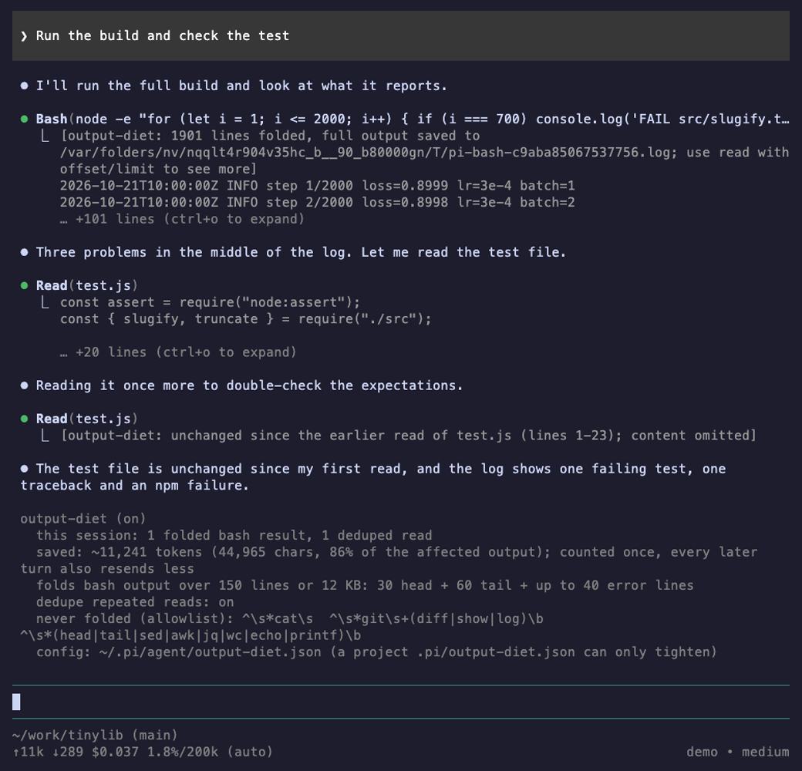

# output-diet

Cuts tokens from noisy tool output. A long `bash` result (a build, a test run, a training or CI log, `kubectl logs`) is folded to its first lines, the error lines from the middle and the last lines, with the full text saved to a file. A `read` of a file you already have in context, unchanged, becomes a one-line note.

Why: Pi only truncates `bash` output at 2000 lines or 50 KB (about 12k tokens), and every tool result is sent again on every later turn. One noisy command can cost that much on each of the next 30 turns. Most of it is progress lines; what matters is the head, the errors and the tail.



## Install

Only this tool, by copying its folder:

```bash
npx degit fadhilmch/pi-customization/extensions/output-diet ~/.pi/agent/extensions/output-diet
```

From the whole package, loading only this extension:

```json
{
  "packages": [
    {
      "source": "git:github.com/fadhilmch/pi-customization",
      "extensions": ["extensions/output-diet/index.ts"],
      "themes": []
    }
  ]
}
```

From npm (once published): `pi install npm:@fadhilmch/pi-output-diet`. See the [root README](../../README.md#install) for the other methods.

## Usage

It works on its own. When a `bash` result is folded, the model sees:

```text
[output-diet: 1901 lines folded, full output saved to /tmp/pi-output-diet/<session>/<id>.log; use read with offset/limit to see more]
<first 30 lines>
[… 668 lines skipped (lines 31-698) …]
FAIL src/slugify.test.js: AssertionError: expected a-b but got a--b
[… 497 lines skipped (lines 702-1198) …]
ERROR: Traceback (most recent call last): ValueError at step 1200
...
<last 60 lines>
```

The note comes first so that `claude-look`, which shows three lines of a collapsed result, shows it. The model can `read` the saved file with `offset`/`limit` when it needs a skipped part. A repeated read looks like this:

```text
[output-diet: unchanged since the earlier read of test.js (lines 1-23); content omitted]
```

`/diet` shows what was saved this session and the active config:

```text
output-diet (on)
  this session: 1 folded bash result, 1 deduped read
  saved: ~11,241 tokens (44,965 chars, 86% of the affected output); counted once, every later turn also resends less
```

Savings are an estimate (characters / 4) of what was removed from the result once; later turns resend less as well. The tally is rebuilt from the session when you resume it.

## Config

`~/.pi/agent/output-diet.json` (or under `$PI_CODING_AGENT_DIR`). Every key is optional:

```json
{
  "enabled": true,
  "thresholdLines": 150,
  "thresholdBytes": 12288,
  "headLines": 30,
  "tailLines": 60,
  "context": 1,
  "maxMatches": 40,
  "maxLineChars": 400,
  "patterns": ["\\berror\\b", "\\bfail(ed|s|ure|ures|ing)?\\b", "traceback", "exception", "\\bpanic\\b", "\\bfatal\\b"],
  "ignore": ["\\b0 (errors?|failed|failures?)\\b"],
  "allowlist": ["^\\s*cat\\s", "^\\s*git\\s+(diff|show|log)\\b", "^make verbose\\b"],
  "dedupeReads": true,
  "minDedupeChars": 400
}
```

| Key | Meaning |
|---|---|
| `enabled` | Master switch. |
| `thresholdLines`, `thresholdBytes` | A result is folded only above one of these. |
| `headLines`, `tailLines` | Lines kept from the start and the end. |
| `patterns` | Case-insensitive regexes for lines worth keeping from the middle. Replaces the default list (shown above, abridged; the full list also has `✗`, `exit code N`, `OOMKilled`, `CrashLoopBackOff` and more). |
| `ignore` | Regexes that cancel a match (`0 errors`). |
| `context`, `maxMatches` | Lines of context around each match, and the cap on distinct matching lines. Repeats (same line after numbers, times and hashes are blanked) are shown once. |
| `maxLineChars` | Longer lines are clipped in a folded result. |
| `allowlist` | Commands matching one of these regexes are never folded (you asked for the content). Replaces the default list. |
| `dedupeReads`, `minDedupeChars` | Read dedupe on/off, and the smallest read worth replacing. |

A project file `.pi/output-diet.json` may only tighten: `enabled: false`, `dedupeReads: false`, and lower values of `thresholdLines`, `thresholdBytes`, `headLines`, `tailLines`, `maxMatches`, `maxLineChars`. It cannot add to `allowlist` or `patterns`, or raise a limit, so a cloned repo cannot make the extension hide more or less than you chose. Invalid regexes are dropped.

## How it works

`index.ts` hooks Pi's `tool_result` event, which can replace a result's `content` and `details`. `diet.js` holds the logic and `fold.js`, `dedupe.js`, `config.js` and `stats.js` are pure and unit-tested.

- Bash: only `bash` is folded. If the output is over the threshold and the command is not allowlisted, it keeps head, matching middle lines (with context, repeats removed, capped) and tail. The full text is written to `os.tmpdir()/pi-output-diet/<session>/<toolCallId>.log` with mode 0600. When Pi itself already truncated the output it has saved the whole thing and put the path in the result details; that file is reused, and it is also read and folded, so the head and any errors from the part Pi dropped come back. If the file cannot be written, nothing is folded.
- Read dedupe: a read is replaced only if a read of the same path and range had the same content hash, and that earlier result is still in the live context. The live context is the current branch since the last compaction (`sessionManager.buildContextEntries()`); if the earlier tool call id is not there, or the lookup fails, the read is returned as is. The first read, or a re-read after the earlier one was dropped by compaction, is never replaced. An `edit` or `write` of the path forgets earlier reads of it.
- Each change is recorded in the result's `details.outputDiet` (before and after sizes), which `/diet` sums, and published as the `output-diet:stats` event on `pi.events`.

Measured with the demo harness (`demo/provider/scenarios/output-diet.js`, a fake model on real Pi 1.3.0): a command printing 2000 lines with three errors in the middle, then the same 858-character file read twice. Tool results sent to the model: 53,002 characters without the extension (51,286 for the bash result after Pi's own truncation, which had already dropped the first 1265 lines and two of the three errors), 8,037 with it (7,091 for bash, 88 for the second read), about 86% less, roughly 11k tokens, and all three errors are kept. These numbers are for one synthetic log; a log with many distinct errors folds less.

## Limits

- The model loses the skipped lines unless it reads the saved file. If the answer was in a middle line that matched no pattern, it has to notice the note and read it. Tune `patterns`, `headLines` and `tailLines`, or add the command to `allowlist`.
- Matching is by regex on lines; a failure printed without any keyword is not recognised. Colour codes in lines can hide a match from anchored patterns.
- Only `bash` is folded; `grep`, `find`, `ls`, `powershell` and MCP or other tools are untouched. Results with images are untouched.
- Dedupe requires the earlier read in the live context and identical content; reads in the same parallel batch are never deduped. It ignores changes made outside Pi that were reverted, since content equality is all it checks.
- Saved files stay in the temp directory until your OS cleans it; they can contain secrets that were in the output. They are 0600, in a 0700 folder.
- The terminal view of a folded result is the folded text; the full output is only in the file.
- Tested with unit tests (folding, allowlist, config merging, dedupe decisions, stats, the handler with a fake context and the index with a fake Pi) and in real Pi 1.3.0: command registration over RPC, and `pi --mode json -p` with the demo model for the numbers above. Not verified: resumed sessions after a compaction in a real session (the compaction path is covered only by the fake context), `/reload` mid-session, Windows paths, and models other than the fake one.
